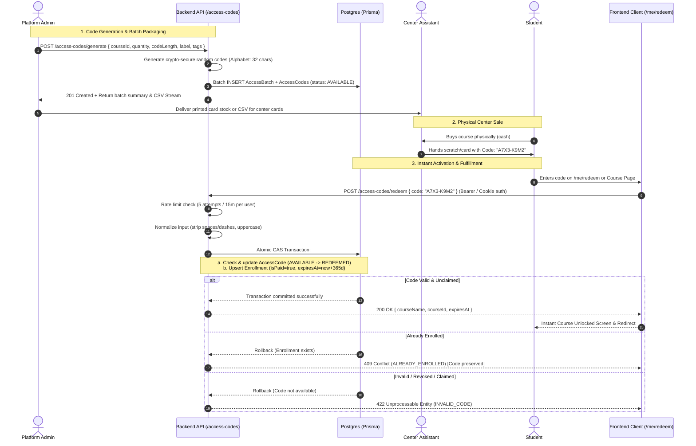

# Access Codes System (نظام أكواد التفعيل)
## Comprehensive Architecture, Specifications & Operations Guide

> **Module Status:** Feature-Gated (`ACCESS_CODES_ENABLED=false` by default)  
> **Architecture Doctrine:** Fully decoupled optional module with zero runtime dependencies on payments, notifications, or AI subsystems.  
> **Target Audience:** Backend Developers, Frontend Engineers, Platform Administrators, and Center Coordinators.

---

## 1. High-Level Flow & Visual Architecture

### 1.1 Complete Lifecycle & Center Distribution Diagram



### 1.2 State Transition Diagram

```mermaid
stateDiagram-v2
    [*] --> AVAILABLE: Admin Generates Batch (1-10,000)
    
    state AVAILABLE {
        description: Code printed on card, distributed to centers, unredeemed
    }

    AVAILABLE --> REDEEMED: Student Submits Valid Code (Atomic CAS)
    AVAILABLE --> REVOKED: Admin Revokes Code or Whole Batch

    state REDEEMED {
        description: Enrollment created (isPaid=true, expiresAt=now+365d). Terminal state.
    }

    state REVOKED {
        description: Code invalidated before use (lost, stolen, misprinted). Terminal state.
    }

    REDEEMED --> [*]
    REVOKED --> [*]
```

---

## 2. Decoupling & Modular Architecture Doctrine

To ensure the platform maintains zero technical debt and no spaghetti dependencies, the Access Codes module adheres to strict architectural boundaries:

1. **Self-Contained Module Boundary:**
   - All backend code lives inside `src/services/accessCodes/`, `src/controllers/accessCodeController.js`, and `src/routes/accessCodeRoutes.js`.
   - The module does **not** import from `src/services/payments/`, `src/services/notifications/`, or `src/services/aiGrader/`.
2. **Shared Integration Surface:**
   - The **only** table modified in common with other features is `Enrollment`.
   - Access codes populate standard `Enrollment` fields (`userId`, `courseId`, `isPaid: true`, `paymentDate: now()`, `expiresAt: now() + 365 days`).
3. **Feature Flag Isolation (`ACCESS_CODES_ENABLED`):**
   - Configured in `src/config/env.js`.
   - Mounts conditionally in `app.js` using lazy `require()`.
   - If `ACCESS_CODES_ENABLED=false`, the router is never mounted; requests return `404 Not Found`. No stub controllers or dead routes exist.
4. **Clean Removal Test:**
   - Deleting the `src/services/accessCodes` folder, its controller, and route file leaves the core platform completely operational and bootable.

---

## 3. Database Specification & Concurrency Mechanics

### 3.1 Prisma Schema Definition

```prisma
model AccessBatch {
  id          Int          @id @default(autoincrement())
  course      Course       @relation(fields: [courseId], references: [id])
  courseId    Int
  quantity    Int
  codeLength  Int          @default(8) // Allowed: 8, 10, 12
  label       String?      // e.g., "سنتر النور - الدفعة الأولى"
  tags        String[]     @default([]) // e.g., ["cairo", "october", "center-al-nour"]
  generatedBy Int          // User ID of Admin
  createdAt   DateTime     @default(now())
  codes       AccessCode[]

  @@index([courseId])
  @@index([generatedBy])
}

model AccessCode {
  id          Int              @id @default(autoincrement())
  code        String           @unique // Stored canonical (uppercase, no dashes)
  batch       AccessBatch      @relation(fields: [batchId], references: [id], onDelete: Cascade)
  batchId     Int
  course      Course           @relation(fields: [courseId], references: [id])
  courseId    Int              // Denormalized for zero-join redemption lookup
  status      AccessCodeStatus @default(AVAILABLE)

  // Audit Fields
  redeemedBy  Int?             // User ID of student
  redeemedAt  DateTime?
  revokedBy   Int?             // User ID of admin who revoked
  revokedAt   DateTime?

  createdAt   DateTime         @default(now())

  @@index([batchId])
  @@index([courseId])
  @@index([status, courseId])
}

enum AccessCodeStatus {
  AVAILABLE
  REDEEMED
  REVOKED
}
```

### 3.2 Concurrency & Atomic CAS (Compare-And-Swap)

To prevent double-spend attacks (e.g., two parallel requests submitting the same code simultaneously), redemption uses an **atomic Prisma transaction**:

```javascript
const result = await prisma.$transaction(async (tx) => {
  // 1. Check if user is already actively enrolled in this course
  const existingEnrollment = await tx.enrollment.findUnique({
    where: {
      userId_courseId: { userId, courseId: codeRow.courseId }
    }
  });

  if (existingEnrollment && existingEnrollment.isPaid) {
    const err = new Error('Already enrolled in this course.');
    err.code = 'ALREADY_ENROLLED';
    err.statusCode = 409;
    throw err; // Code remains untouched (AVAILABLE)
  }

  // 2. Atomic Compare-And-Swap update on the code
  const updateResult = await tx.accessCode.updateMany({
    where: {
      id: codeRow.id,
      status: 'AVAILABLE' // CAS invariant
    },
    data: {
      status: 'REDEEMED',
      redeemedBy: userId,
      redeemedAt: new Date()
    }
  });

  if (updateResult.count === 0) {
    const err = new Error('Invalid or already redeemed code.');
    err.code = 'INVALID_CODE';
    err.statusCode = 422;
    throw err;
  }

  // 3. Upsert Enrollment
  const now = new Date();
  const expiresAt = new Date(now.getTime() + 365 * 24 * 60 * 60 * 1000);

  const enrollment = await tx.enrollment.upsert({
    where: {
      userId_courseId: { userId, courseId: codeRow.courseId }
    },
    update: {
      isPaid: true,
      paymentDate: now,
      expiresAt: expiresAt
    },
    create: {
      userId,
      courseId: codeRow.courseId,
      isPaid: true,
      paymentDate: now,
      expiresAt: expiresAt
    }
  });

  return { enrollment, courseName: codeRow.course.title };
});
```

---

## 4. API Endpoints Specification

### 4.1 Admin Endpoints (`/access-codes/*`)
*Guarded by `authenticateToken, authorizeAdmin()`*

| Method | Path | Description | Payload / Query |
|---|---|---|---|
| `POST` | `/access-codes/generate` | Generate batch of 1–10,000 codes | `{ courseId, quantity, codeLength, label, tags }` |
| `GET` | `/access-codes/batches` | List batches with pagination & filter | `?courseId=&search=&page=&limit=` |
| `GET` | `/access-codes/batches/:id` | View batch details & individual codes | `?status=&search=&page=&limit=` |
| `GET` | `/access-codes/batches/:id/download` | Export batch codes as formatted CSV | *None (Returns attachment download)* |
| `POST` | `/access-codes/revoke` | Revoke specific individual codes | `{ codeIds: [101, 102] }` |
| `POST` | `/access-codes/revoke-batch` | Revoke all AVAILABLE codes in batch | `{ batchId: 42 }` |
| `GET` | `/access-codes/lookup/:code` | Triage / inspect any code status | *Path param (raw or formatted)* |

### 4.2 Student Endpoints
*Guarded by `authenticateToken` + Rate Limiter (`5 attempts / 15 mins`)*

| Method | Path | Description | Payload |
|---|---|---|---|
| `POST` | `/access-codes/redeem` | Activate course access using code | `{ code: "A7X3-K9M2" }` |

---

## 5. Security & Anti-Abuse Controls

1. **Unambiguous Character Set:**
   Alphabet: `ABCDEFGHJKMNPQRSTUVWXYZ23456789` (32 characters).
   Excludes easily confused characters: `0`, `O`, `1`, `I`, `L`.
2. **Entropy:**
   - 8 characters: $32^8 \approx 1.099 \times 10^{12}$ combinations.
   - 10 characters: $32^{10} \approx 1.125 \times 10^{15}$ combinations.
   - 12 characters: $32^{12} \approx 1.152 \times 10^{18}$ combinations.
3. **Throttling & IP Lockout:**
   - Redemption endpoint limited to **5 attempts per 15 minutes per user/IP**.
   - After 5 failures, HTTP 429 (`RATE_LIMITED`) blocks further attempts.
4. **Information Leakage Prevention:**
   - Redemption errors return a uniform generic message: *"هذا الكود غير صالح أو تم استخدامه بالفعل"* (`INVALID_CODE`).
   - Attacker cannot distinguish between a code that never existed, a code that was already used, or a code that was revoked.
5. **No Code Loss on Double Enrollment:**
   - If a student tries to redeem a code for a course they already own, the API responds with `409 Conflict` (`ALREADY_ENROLLED`) and **aborts without consuming the code**. The card remains valid for another student.

---

## 6. Operations & Usage Guide

### 6.1 Administrator Workflow (Generating & Printing)

1. **Accessing the Console:**
   - Log in to the Admin Dashboard (`/admin`).
   - Click the **أكواد التفعيل (Access Codes)** tab.
2. **Generating a Batch:**
   - Select the target course (e.g., *الفيزياء - الصف الأول الثانوي*).
   - Enter the required quantity (e.g., `500`).
   - Choose Code Length (`8` characters recommended for ease of typing).
   - Add a descriptive label (e.g., `سنتر الأهرام - الجيزة - دفعة أكتوبر 2026`).
   - Optional tags for quick filtering (e.g., `giza, center-ahram, physics`).
   - Click **إنشاء الأكواد (Generate)**.
3. **Exporting for Print:**
   - Once generated, click **تحميل ملف CSV (Download CSV)**.
   - Hand the CSV file to the print house / card manufacturer.
   - Format on physical scratch cards:
     ```
     ┌──────────────────────────────────────────────────┐
     │  منصة الأستاذ التعليمية                          │
     │  كورس: فيزياء الصف الأول الثانوي                │
     │                                                  │
     │  كود التفعيل الخاص بك:                           │
     │  [    A 7 X 3 - K 9 M 2    ]                     │
     │                                                  │
     │  خطوات التفعيل:                                 │
     │  1. ادخل على المنصة وسجل الدخول                  │
     │  2. افتح صفحة "تفعيل كود" (me/redeem)           │
     │  3. اكتب الكود واضغط تفعيل                       │
     └──────────────────────────────────────────────────┘
     ```

### 6.2 Center Assistant Workflow (Sales & Inquiries)

1. **Card Handling:**
   - Keep cards organized by course and batch label.
   - Sell the card at the center desk for the agreed physical price.
2. **Handling Student Issues:**
   - If a student claims their card "doesn't work", ask for the card or code string.
   - Report the code to the platform administrator for lookup via `GET /access-codes/lookup/:code`.
   - The admin can verify if and when the code was activated, and which student account claimed it.

### 6.3 Student Workflow (Redemption)

1. **Direct Redemption:**
   - Student navigates to `/me/redeem`.
   - Types or pastes the code (case-insensitive, dashes or spaces are automatically stripped).
   - Clicks **تفعيل الكود**.
   - Immediate success notification displays with link to start watching lectures.
2. **From Course Purchase Page:**
   - On `/course/[id]`, student sees two options:
     - 💳 *شراء إلكتروني (Online Payment)* (if enabled)
     - 🔑 *تفعيل بكود السنتر (Activate with Center Code)*
   - Clicking code activation opens a modal to enter the code directly without leaving the course page.

---

## 7. Frontend Integration Checklist

| Item | Component / Page | Location | Notes |
|---|---|---|---|
| 1 | Admin Access Codes Page | `app/admin/access-codes/page.tsx` | Batch creation, listing, code lookup, CSV download |
| 2 | Student Redeem Page | `app/me/redeem/page.tsx` | Clean input box, auto-formatting, success celebration screen |
| 3 | Course Page Code CTA | `app/course/[id]/page.tsx` | "لديك كود تفعيل؟" button & quick activation modal |
| 4 | API Client Service | `services/accessCodeService.ts` | Typed wrappers for all endpoints |
| 5 | TypeScript Definitions | `types/accessCode.ts` | Full request/response and model typings |
| 6 | Navigation Links | `components/layout/Sidebar.tsx` | Add "أكواد التفعيل" for Admin & "تفعيل كود" for Students |
