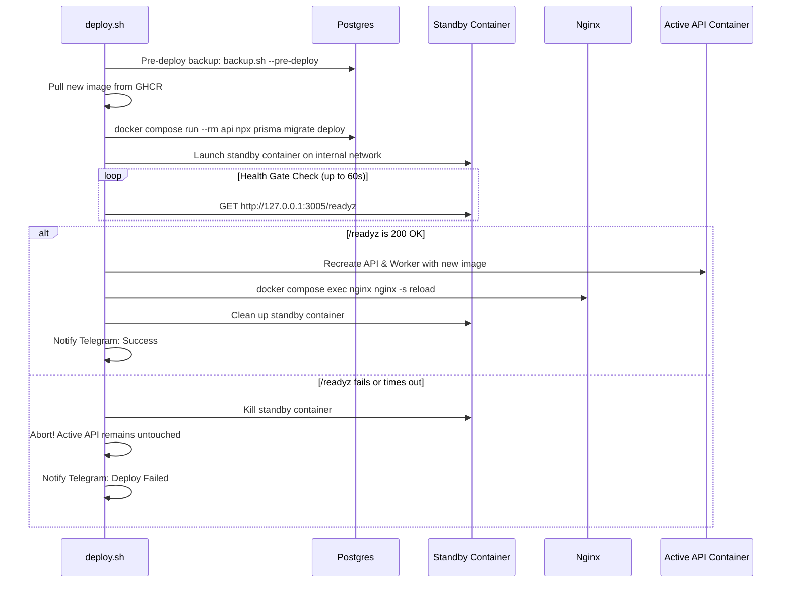

# Runbook: Deployments & Rollouts

This runbook documents how changes are shipped to Canary and production teacher instances safely and repeatably.

---

## 1. Automated GitHub Actions Deploy (Standard Path)

1. **Trigger:**
   - Merging or pushing to `main` automatically triggers `.github/workflows/deploy.yml`.
   - Alternatively, trigger manually from GitHub Actions UI -> **Build & Deploy to VPS Fleet** -> **Run workflow** (select target: `canary` or `all`).

2. **Progression Pipeline:**
   ```
   [Build & Push to GHCR] ──► [Deploy to Canary] ──► [Smoke Tests] ──► [Sequential Rollout to Teachers]
   ```

3. **Canary Gate:**
   - Ahmed's demo instance (`CANARY_HOST`) receives every build first.
   - GitHub Actions runs automated smoke tests against the Canary domain:
     - `/healthz` (liveness)
     - `/readyz` (readiness with DB check)
   - If Canary tests fail, rollout stops immediately. **Zero teacher servers are touched.**

4. **Sequential Teacher Rollout:**
   - Each teacher VPS is deployed one at a time.
   - For each teacher, `deploy.sh` runs:
     1. Pre-deploy database dump.
     2. `prisma migrate deploy` in a one-off container.
     3. Standby container readiness verification (`/readyz`).
     4. Upstream swap and container recreation.
     5. Nginx reload.
   - If any step fails on a teacher server, that teacher is automatically rolled back, deployment halts, and a Telegram alert is sent.

---

## 2. Manual CLI Deploy (Direct on VPS)

If deploying manually from SSH on a specific tenant VPS:

```bash
ssh deploy@<VPS_IP>
cd /opt/teacher-app

# Pull and deploy a specific git SHA or latest
bash deploy/scripts/deploy.sh --tag <GIT_SHA>

# Or with a preset resize:
bash deploy/scripts/deploy.sh --tag <GIT_SHA> --preset 4000
```

---

## 3. What Happens Under the Hood in `deploy.sh`


